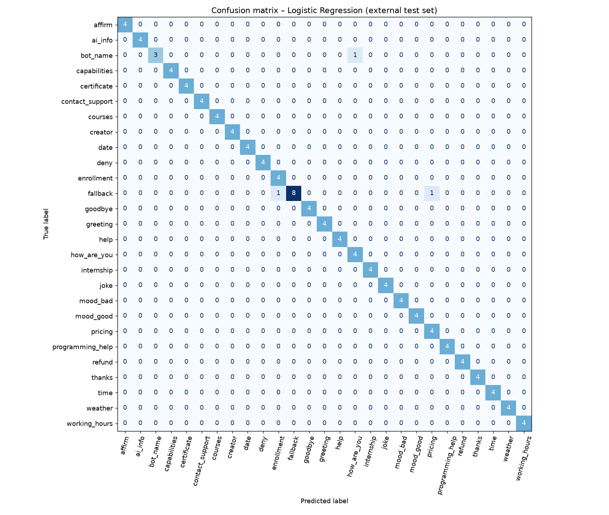

# AI Chatbot using NLP

A question-answering chatbot ("Cogni") built with Python. It recognises the **intent** of a user's
message using NLP + machine learning and replies with a suitable response. It has a Flask web UI and a
terminal mode.

> Cognevance Technologies – AI & ML Project Tasks, **Level 2 (Intermediate)**

## Workflow

```
user message
   │
   ▼
[Preprocessing]  lower-case → expand contractions/slang → tokenise → remove filler words → stem (NLTK Porter)
   │
   ▼
[Features]       TF-IDF on unigrams + bigrams
   │
   ▼
[Intent model]   Logistic Regression  → probability for each of 27 intents
   │
   ├── confidence ≥ 0.20 → pick a response for that intent (time/date/name filled in dynamically)
   └── confidence < 0.20 or "fallback" class → "Sorry, I didn't understand…"
```

Extras: remembers the user's name ("my name is Asha"), live time/date answers, an explicit
out-of-scope class so unrelated questions are politely rejected.

## Technologies
Python · NLTK · scikit-learn · pandas · matplotlib · Flask · HTML/CSS/JS

## Project structure
```
data/            intents.json (training data) · test_queries.csv (separate test set) · build_intents.py
src/             config · preprocess · train · evaluate · chatbot
models/          intent_model.joblib   (trained model)
outputs/         metrics.json · model_comparison.csv · classification_report.csv ·
                 misclassified_queries.csv · sample_conversation.md · figures/
templates/       index.html (chat UI)
tests/           unit tests
app.py           Flask web app          chat_cli.py   terminal chat
main.py          train + evaluate + sample conversation
REPORT.md        project report
```

## How to run
```bash
pip install -r requirements.txt

python main.py          # trains, compares models, evaluates, writes outputs/
python app.py           # web UI  → open http://127.0.0.1:5000
python chat_cli.py      # or chat in the terminal
python -m unittest discover -s tests -v    # run the tests
```
A trained model is already included in `models/`, so `python app.py` works straight away.

**Customise the bot:** edit the intents/patterns/responses in `data/build_intents.py`, then run
`python data/build_intents.py` followed by `python main.py`. (Replace the placeholder contact email in the
`contact_support` response with your real one.)

## Results
Evaluated on 114 hand-written queries that are **not** in the training data (including 10 out-of-scope ones):

| Metric | Value |
|---|---|
| Accuracy | **97.4 %** |
| Macro F1 | 0.978 |
| Accuracy on in-scope questions | 99.0 % |
| Out-of-scope questions correctly rejected | 80 % (8 of 10) |

| Model | 5-fold CV acc. | External test acc. |
|---|---|---|
| **Logistic Regression** (chosen) | 0.622 | 0.974 |
| Linear SVM (calibrated) | 0.620 | 0.947 |
| Naive Bayes | 0.597 | 0.939 |

See [REPORT.md](REPORT.md) for the discussion and limitations.

## Screenshots
Add your own screenshots to the `screenshots/` folder (web UI chat + terminal output of `main.py`) and
link them here, for example:

```


```
